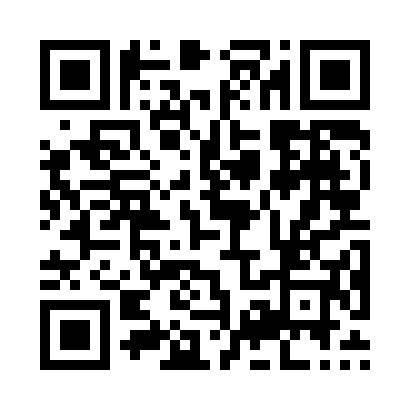
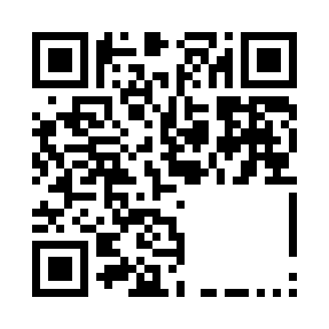
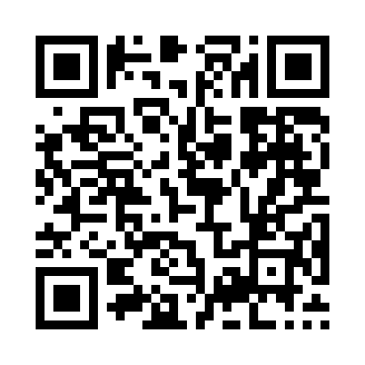
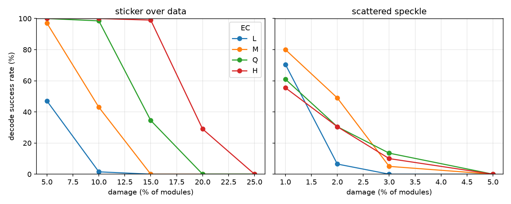

# qr-damage

How much of a QR code can you destroy before it stops scanning? This measures it,
rather than repeating the folklore figure of "about 30%".

The short answer: **where** you damage it matters far more than **how much**.

- A sticker covering **15%** of a level-H symbol still scanned 99 times out of 100.
- **Scattered** damage of only 3% killed it almost every time, at every error-correction level.
- Erasing **0.7%** of the modules — half the timing row — killed it outright.







## Run it

```bash
pip install segno opencv-python-headless pillow numpy matplotlib
python damage.py
```

Generation is [segno](https://segno.readthedocs.io/), decoding is OpenCV's
`QRCodeDetector`, and damage is applied to the module matrix before rendering,
so "15% damaged" means exactly that fraction of modules.

One trap worth knowing: segno raises the error-correction level automatically if
it fits the same version, so `error='l'` can quietly give you level M. Pass
`boost_error=False` or you will measure the wrong thing, as I did at first.

MIT licensed.

## Contributing

Issues and pull requests are welcome, and especially so during Hacktoberfest.
The [good first issues](https://github.com/DimitrovK/qr-damage/issues?q=is%3Aissue+is%3Aopen+label%3A%22good+first+issue%22)
are deliberately small: charting the damage curves, adding the targeted-damage
mode from the write-up, comparing a second decoder, and testing the mask.
